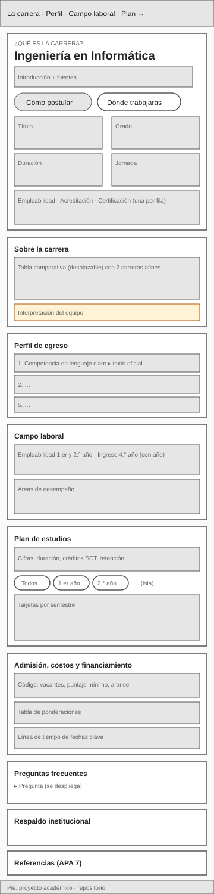
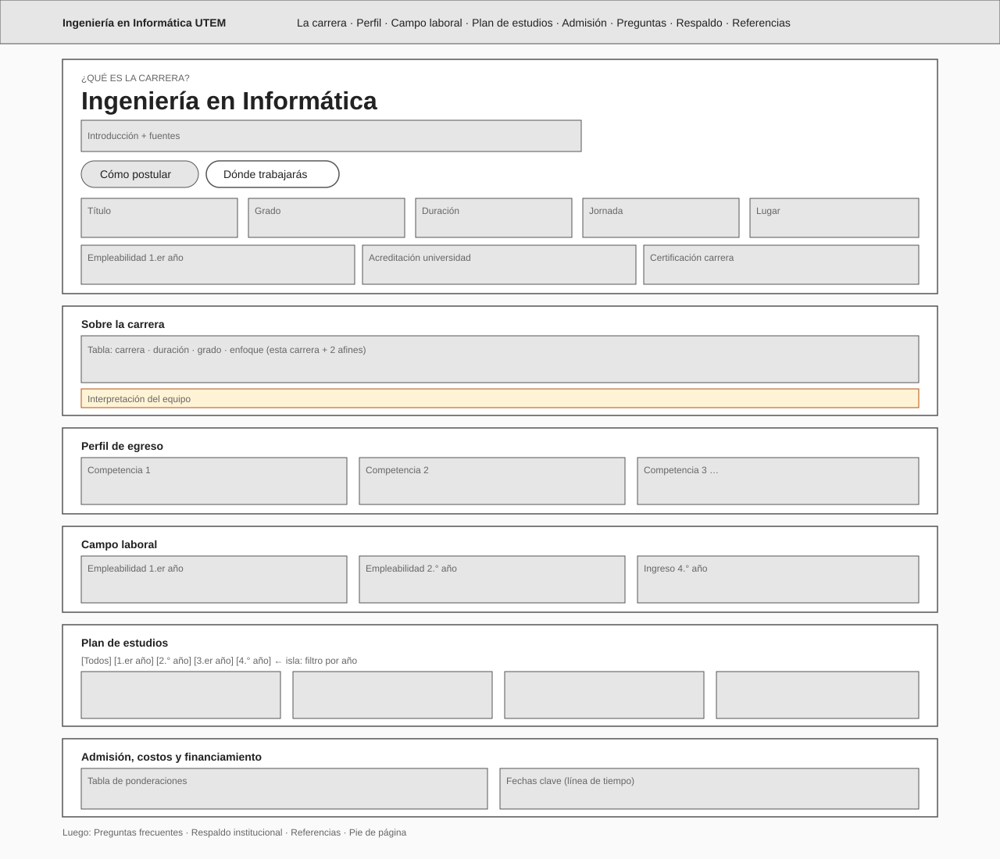

# Informe del proyecto: landing page de Ingeniería en Informática UTEM

| | |
|---|---|
| **Asignatura** | EFE685 – Electivo de Computación Móvil |
| **Unidad académica** | Departamento de Informática y Computación, Facultad de Ingeniería, UTEM |
| **Docente** | Sebastián Salazar Molina |
| **Integrantes** | Mauricio Herraz C. (RUT [completar]) · [Nombre completo integrante 2] (RUT [completar]) · [Nombre completo integrante 3] (RUT [completar]) |
| **Fecha de entrega** | 13 de noviembre de 2026 |
| **Sitio publicado** | https://m4ur1c1o0.github.io/proyecto_web_astro/ |
| **Repositorio** | https://github.com/M4UR1C1O0/proyecto_web_astro |

> Las marcas **[completar]** indican información que solo el equipo puede aportar (nombres, RUT, resultados de la prueba con usuarios, reflexiones y aportes). No se rellenaron para no inventar datos.

## Índice

1. [Resumen](#1-resumen)
2. [Encargo y público objetivo](#2-encargo-y-público-objetivo)
3. [Planificación de contenido](#3-planificación-de-contenido)
   - [3.1 Fase A — Fuentes](#31-fase-a--fuentes)
   - [3.2 Fase B — Audiencia](#32-fase-b--audiencia)
   - [3.3 Fase C — Arquitectura de información](#33-fase-c--arquitectura-de-información)
   - [3.4 Fase D — Redacción](#34-fase-d--redacción)
   - [3.5 Fase E — Validación](#35-fase-e--validación)
4. [Implementación](#4-implementación)
5. [Cómo actualizar la información](#5-cómo-actualizar-la-información)
6. [Reflexiones del equipo](#6-reflexiones-del-equipo)
7. [Referencias](#7-referencias)
8. [Anexos](#anexos)

---

## 1. Resumen

Construimos una página web de una sola vista que presenta la carrera de Ingeniería en Informática de la Universidad Tecnológica Metropolitana (UTEM). Está pensada para estudiantes de 3.° y 4.° medio, sus familias y personas que evalúan cambiarse de carrera o empezar a estudiar después de los 20 años.

Antes de diseñar, investigamos. Evaluamos 22 fuentes, 20 de ellas primarias, es decir, publicadas por quien produce el dato. El sitio usa 16. También encuestamos al público objetivo: recibimos 11 respuestas, de las cuales 8 fueron válidas. Con esas respuestas decidimos qué mostrar y en qué orden.

Cada cifra del sitio indica su año y enlaza a la fuente de donde proviene. Lo que redactamos nosotros se distingue con el rótulo «Interpretación del equipo».

El sitio obtiene 100 en las cuatro categorías de Lighthouse, en móvil y en escritorio, y no presenta errores de accesibilidad WCAG 2.2 AA en la revisión automática (Anexo F).

## 2. Encargo y público objetivo

La Dirección de la Escuela (cliente ficticio de esta actividad) necesita una página de una sola vista para atraer postulantes con información verificable. Las páginas de promoción de carreras suelen usar frases publicitarias sin respaldo. Este encargo invierte ese orden: primero se investiga y se planifica el contenido, y solo después se diseña y programa.

**Para quién es:**

- Público principal: estudiantes de 3.° y 4.° medio y sus familias.
- Público secundario: personas que buscan cambiarse de carrera y personas de 20 años o más que ya terminaron la enseñanza media.

**Qué preguntas debe responder:**

1. ¿Qué es esta carrera y en qué se diferencia de carreras afines?
2. ¿Qué aprenderé y cómo está organizado el plan de estudios?
3. ¿Qué podré hacer al egresar y dónde trabajan los titulados?
4. ¿Qué respaldo institucional tiene la carrera?
5. ¿Cómo postulo y qué necesito?

**Reglas que seguimos:**

- Ninguna cifra, porcentaje o dato verificable aparece sin su fuente citada en el sitio.
- No usamos frases publicitarias sin evidencia, como «la mejor carrera» o «líder del mercado».
- No usamos testimonios. Las personas encuestadas pidieron conocer experiencias de estudiantes, pero no reunimos testimonios con consentimiento escrito a tiempo, y no quisimos inventarlos.
- Las imágenes son propias o tienen licencia abierta con su crédito. El logo de la UTEM se usa con autorización (Anexo I). No usamos fotografías del sitio web de la UTEM.

**Qué entregamos:** el sitio publicado, el repositorio con su historial de cambios, un README para personas no técnicas y este informe.

## 3. Planificación de contenido

### 3.1 Fase A — Fuentes

**Cómo buscamos.** Partimos de las preguntas que debe responder la página y buscamos, para cada una, quién produce ese dato. Priorizamos fuentes primarias: documentos de la universidad, del Ministerio de Educación (Mineduc), del Departamento de Evaluación, Medición y Registro Educacional (DEMRE) y de la Comisión Nacional de Acreditación (CNA).

**Cómo evaluamos cada fuente.** Revisamos cinco criterios antes de usarla:

| Criterio | Pregunta |
|---|---|
| Autoridad (A) | ¿Quien la publica es responsable del dato? |
| Vigencia (V) | ¿Es la versión más reciente? ¿De qué año es el dato? |
| Trazabilidad (T) | ¿Cualquier persona puede abrirla y comprobarla? |
| Objetividad (O) | ¿Distingue datos de publicidad? |
| Pertinencia (P) | ¿Responde alguna de las preguntas del encargo? |

**Decisiones importantes y por qué:**

- **Usamos siempre la versión más reciente.** Para la admisión usamos la oferta oficial del DEMRE para 2027 (F19), publicada el 24 de septiembre de 2026. Reemplazó a la oferta UTEM 2026 (F06), que además ya no está disponible en su dirección original.
- **Distinguimos dos tipos de respaldo.** La acreditación de la universidad la entrega la CNA (F16). La carrera, en cambio, está *certificada* por agencias acreditadoras (F01). En el sitio presentamos ambos datos por separado, para no confundirlos.
- **Elegimos el dato de acreditación más reciente.** Una nota de prensa (F13) informaba una vigencia «hasta octubre de 2031». El registro oficial de la CNA indica el 26-03-2031. Usamos la CNA. Mi Futuro todavía mostraba «4 años», un dato desactualizado.
- **Fuimos a la fuente original de las cifras.** El folleto de la carrera (F02) trae empleabilidad sin año. No usamos esas cifras. Tomamos las de Mi Futuro (F04) y su metodología oficial (F17), que indica qué generaciones de titulados mide cada indicador.
- **Comparamos con carreras afines de la misma universidad.** Usamos las fichas oficiales de Ingeniería Civil en Computación mención Informática (F21) e Ingeniería Civil en Ciencia de Datos (F20). Al venir de la misma institución, presentan título, grado y duración en el mismo formato. Inicialmente consideramos un perfil de la Universidad de Santiago de Chile (F12), pero el equipo decidió dejarlo fuera para comparar dentro de una misma oferta.
- **Contrastamos los datos que aparecían sin año.** La página de la carrera muestra ponderaciones y vacantes sin indicar el proceso. Las comparamos con la oferta DEMRE 2027 antes de usarlas (ver Fase E).
- **Usamos fuentes secundarias solo como contexto.** Las noticias y blogs sirvieron para ubicar información, pero ningún dato del sitio se apoya en ellas.

**Resultado.** Evaluamos 22 fuentes: 20 primarias y 2 secundarias. El sitio usa 16, todas primarias. La matriz completa, con la evaluación justificada de cada criterio, está en el [Anexo A](#anexo-a--matriz-de-fuentes).

### 3.2 Fase B — Audiencia

**Por qué preguntamos en vez de suponer.** Una página de carrera suele organizarse según lo que la universidad quiere contar. Quisimos organizarla según lo que los postulantes necesitan saber.

**Cómo lo hicimos.** Aplicamos un cuestionario en Google Forms durante noviembre de 2026, con ocho preguntas:

- una pregunta de perfil (estudiante de 3.° o 4.° medio, familiar, persona que piensa cambiarse de carrera o persona de 20 años o más);
- cuatro preguntas cerradas: qué buscaría primero, qué le preocupa, dónde busca información y desde qué dispositivo;
- tres preguntas abiertas: su principal duda, qué información la resolvería y qué le haría confiar en una página de carrera.

Cada pregunta alimenta una decisión concreta. Por ejemplo, «qué buscaría primero» define el orden de las secciones, y «desde qué dispositivo» define si conviene diseñar primero para celular.

**Cómo cuidamos a los participantes.**

- Antes de responder, cada persona leyó y aceptó un texto de consentimiento informado.
- La encuesta fue anónima: no pedimos nombre, RUT, correo ni teléfono.
- Las personas menores de 18 años confirmaron que su madre, padre o apoderado estaba de acuerdo.
- En este informe cada participante aparece con un código (P1, P2…). Las respuestas originales se guardan fuera del repositorio, disponibles para el docente.

**Cómo la difundimos.** Por WhatsApp (mensajes directos y grupos) y en historias de Instagram.

**Quiénes respondieron.** Recibimos 11 respuestas. Excluimos tres porque las personas no pertenecían al público objetivo. Analizamos 8 respuestas válidas; dos eran de menores de 18 años con apoderado informado.

| Perfil | Participantes |
|---|---|
| Estudiante de 3.° medio | 3 |
| Estudiante de 4.° medio | 0 |
| Familiar de un postulante | 0 |
| Persona que piensa cambiarse de carrera | 2 |
| Persona de 20 años o más que quiere empezar a estudiar | 3 |

**Limitación:** no respondieron estudiantes de 4.° medio ni familiares. La muestra es pequeña: sirve para orientar decisiones, no para generalizar.

**Qué encontramos:**

1. **Lo primero que quieren saber es qué podrán hacer al titularse.** Seis de ocho lo marcaron entre sus tres prioridades. Ninguna otra opción superó las tres menciones.

   | Qué querrían saber primero | Menciones (de 8) |
   |---|---|
   | Qué podré hacer cuando me titule | 6 |
   | Qué es la carrera y en qué se diferencia de otras | 3 |
   | Qué asignaturas tiene y cuánto dura | 3 |
   | Dónde trabajan los titulados y cuánto ganan | 3 |
   | Cómo postular: requisitos, puntajes y fechas | 3 |
   | Cuánto cuesta y qué becas o gratuidad existen | 3 |
   | Si la carrera y la universidad están acreditadas | 1 |

2. **Su principal duda es el trabajo.** En sus propias palabras, cinco de ocho preguntaron por encontrar trabajo, por el sueldo o por la amplitud del campo laboral. Por ejemplo: «¿Voy a encontrar trabajo cuando me titule?» (P7). Agrupar las respuestas abiertas por tema es una interpretación del equipo.

3. **Sus preocupaciones tienen que ver con la preparación previa.**

   | Preocupación | Menciones (de 7 que respondieron) |
   |---|---|
   | No saber programar o no tener base previa | 3 |
   | Que sea muy difícil o tenga mucha matemática | 3 |
   | Compatibilizar con trabajo o familia | 2 |
   | No saber si le va a gustar | 2 |
   | No alcanzar el puntaje o los requisitos | 2 |
   | Que no encuentre trabajo al titularse | 2 |
   | No poder pagarla | 1 |

4. **Buscan información en Google y en asistentes de inteligencia artificial.** Cinco usan buscadores y cinco usan herramientas como ChatGPT. Cuatro revisan el sitio de la universidad. Por eso la página necesita títulos claros y datos fáciles de citar.
5. **No hay un dispositivo dominante.** Tres usarían el celular, dos el computador, una la tableta y a dos les da lo mismo.
6. **Confían en experiencias reales y en fuentes visibles.** Tres pidieron conocer la experiencia de estudiantes. Otras valoraron que la página muestre sus fuentes y esté ordenada.

**Perfil de usuario (persona)**

| Rasgo | Descripción | Respaldo |
|---|---|---|
| Contexto | Persona que evalúa estudiar Ingeniería en Informática: estudiante de 3.° medio, adulto de 20 años o más, o alguien que piensa cambiarse de carrera. | Pregunta 1 |
| Preguntas principales | ¿Qué podré hacer al titularme? ¿Encontraré trabajo? ¿Cuánto ganaré? | P. 2: 6 de 8 · P. 3: 5 de 8 |
| Dudas | Si necesita saber programar y si la carrera tiene mucha matemática. | P. 4: 3 de 7 cada una |
| Barreras | Compatibilizar estudio con trabajo o familia, alcanzar el puntaje y no saber si le gustará. | P. 4: 2 de 7 cada una |
| Canal de llegada | Buscadores y asistentes de IA; después, el sitio de la universidad. | P. 6: 5, 5 y 4 de 8 |
| Qué le genera confianza | Experiencias reales, fuentes visibles e información ordenada. | P. 8 (abiertas) |

**Preguntas priorizadas para la sección de preguntas frecuentes** (ordenadas según frecuencia):

| # | Pregunta | Origen |
|---|---|---|
| 1 | ¿Voy a encontrar trabajo cuando me titule? | Duda principal, 5 de 8 |
| 2 | ¿Cuánto gana un ingeniero en informática? | Duda principal, 5 de 8 |
| 3 | ¿Necesito saber programar antes de entrar? | Preocupación, 3 de 7 |
| 4 | ¿Tiene mucha matemática? | Preocupación, 3 de 7 |
| 5 | ¿Cuánto cuesta y qué becas o gratuidad hay? | Prioridad, 3 de 8 |
| 6 | ¿Puedo estudiar y trabajar al mismo tiempo? | Preocupación, 2 de 7 |
| 7 | ¿En qué me puedo especializar? | Respuestas abiertas |

El instrumento está en el [Anexo B](#anexo-b--instrumento-de-la-encuesta-y-consentimiento) y las respuestas anonimizadas, en el [Anexo C](#anexo-c--resultados-anonimizados).

### 3.3 Fase C — Arquitectura de información

**Criterio general.** Ordenamos la página según lo que el público quiere saber primero (Fase B), no según lo que la universidad suele contar. Es una página de una sola vista con un menú fijo que lleva directo a cada sección.

**Orden de las secciones y por qué**

| # | Sección | Prioridad | Por qué va en este lugar |
|---|---|---|---|
| 1 | Portada | — | Muestra en una pantalla el nombre, título, grado, duración, jornada y lugar. Agrega empleabilidad y acreditación, y dos botones: «Cómo postular» y «Dónde trabajarás». Como muchos llegan desde buscadores o IA (5 de 8 cada uno), lo esencial debe verse sin bajar. |
| 2 | Sobre la carrera | Secundaria | Explica en qué se diferencia de dos carreras afines (3 de 8 lo pidieron). Es breve para no retrasar lo principal. |
| 3 | Perfil de egreso | Principal | Responde la prioridad más mencionada: «qué podré hacer cuando me titule» (6 de 8). |
| 4 | Campo laboral | Principal | La duda más escrita fue el trabajo y el sueldo (5 de 8). Va justo después del perfil porque ambos responden qué viene después de estudiar. |
| 5 | Plan de estudios | Principal | Las preocupaciones más mencionadas fueron programar y la matemática (3 de 7 cada una). La malla real muestra cómo empieza la carrera. |
| 6 | Admisión, costos y financiamiento | Secundaria | 3 de 8 preguntaron cómo postular y 3 de 8 por costos. Separamos lo que necesita quien está en 4.° medio (ponderaciones y fechas) de quien está en 3.° medio. Esa separación es interpretación del equipo, porque no respondieron estudiantes de 4.° medio. |
| 7 | Preguntas frecuentes | Secundaria | Reúne las 7 preguntas reales de la encuesta. Va después de Admisión para resolver las dudas que frenan la decisión. |
| 8 | Respaldo institucional | Secundaria | Solo 1 de 8 lo eligió como prioridad, por eso va abajo. La acreditación igual aparece en la portada. |
| 9 | Referencias | Soporte | No responde una pregunta por sí sola, pero respalda todas. La confianza depende de ver las fuentes (P. 8). |

**Decisiones de estructura**

- **Diseño para todos los tamaños de pantalla.** No hay un dispositivo dominante, así que diseñamos primero para celular y luego ampliamos.
- **Cada sección dice qué pregunta responde.** Sobre cada título aparece la pregunta del público, por ejemplo «¿Qué podré hacer al titularme?».
- **Cifras con año y enlace.** Ninguna cifra aparece sola.

**Wireframes.** Los bocetos de baja fidelidad para celular (360 px) y escritorio (1280 px) están en el [Anexo D](#anexo-d--wireframes).

**Relación sección → dato → fuente**

| Sección | Dato que aporta | Fuentes |
|---|---|---|
| Portada | Título, grado, duración, jornada, lugar, empleabilidad y acreditación | F01, F02, F03, F04, F16, F17, F19 |
| Sobre la carrera | Propósito formativo y comparación con 2 carreras afines | F01, F02, F20, F21 |
| Perfil de egreso | Competencias reescritas en lenguaje claro | F02 |
| Campo laboral | Empleabilidad, ingresos con año del dato y áreas de desempeño | F02, F04, F17 |
| Plan de estudios | Malla por semestre, créditos SCT, retención y duración real | F02, F03, F04, F17 |
| Admisión, costos y financiamiento | Código, vacantes, puntaje mínimo, ponderaciones, fechas, arancel, matrícula y gratuidad | F01, F02, F07, F09, F10, F18, F19 |
| Preguntas frecuentes | Respuestas a las 7 preguntas reales | F01, F02, F04, F07, F17 |
| Respaldo institucional | Acreditación, certificación, cuerpo académico y laboratorios | F01, F05, F16, F22 |
| Referencias | Lista APA 7 con fecha de consulta | Todas las usadas |
| Pie de página | Colores institucionales | F15 |

### 3.4 Fase D — Redacción

**Guía de estilo que aplicamos**

| Regla | Cómo la aplicamos |
|---|---|
| Lenguaje claro | Oraciones de menos de 25 palabras, en voz activa y sin jerga sin explicar. |
| Siglas | La primera vez se escriben completas: Universidad Tecnológica Metropolitana (UTEM), Comisión Nacional de Acreditación (CNA), Sistema de Créditos Transferibles (SCT), Prueba de Acceso a la Educación Superior (PAES), etc. En las citas breves la sigla muestra el nombre completo al pasar el cursor. |
| Cifras | Cada cifra muestra su período («Titulados 2021 a 2023», «Admisión 2027») y una cita breve enlazada a Referencias. |
| Citas | Formato APA 7 en el texto: (UTEM, s.f.-d). La letra distingue obras del mismo autor y año. |
| Imágenes | La foto de la portada tiene texto alternativo descriptivo y crédito visible (autor, licencia y enlace). Los íconos son dibujos propios, decorativos y ocultos a lectores de pantalla. |

**Cómo distinguimos dato, interpretación y testimonio**

- **Dato institucional:** texto sin marca especial, siempre seguido de «Fuente: (…)». Las frases tomadas literalmente de una fuente van entre comillas angulares «…».
- **Interpretación del equipo:** recuadro amarillo con el rótulo **«Interpretación del equipo:»**. Por ejemplo, la conclusión de la comparación con carreras afines.
- **Testimonio:** no usamos. Si se agregan, deben llevar consentimiento escrito y el rótulo «Opinión personal».

**Perfil de egreso en lenguaje claro.** Reescribimos cada competencia del folleto oficial (F02) con palabras simples. El texto original queda disponible al desplegar «Ver texto oficial», para que cualquiera compare. Ejemplo:

| Texto oficial (F02) | Versión del sitio |
|---|---|
| «Organizarás los recursos asociados a redes informáticas para establecer la comunicación de datos.» | «Organizar redes informáticas para que los datos se comuniquen.» |

**Dónde están los textos finales.** Todos los textos del sitio están en archivos JSON dentro de `src/content/`, separados por tipo de contenido (Producto D).

### 3.5 Fase E — Validación

#### Revisión cruzada de cifras

Comparamos cada cifra con al menos una segunda fuente o con la versión más reciente. Estos fueron los hallazgos y lo que hicimos:

| # | Afirmación revisada | Hallazgo | Corrección aplicada |
|---|---|---|---|
| 1 | Ponderaciones de admisión (F01) | La página de la carrera suma 110 %: muestra las dos electivas con 10 % cada una. | La oferta DEMRE 2027 (F19) aclara «Historia 10 **o** Ciencias 10». El sitio muestra una fila «una de las dos» y el total calculado da 100 %. |
| 2 | Vacantes | F06 (oferta 2026) decía 135; F01 decía 150. | F19 confirma 150 vacantes regulares para 2027, más 30 +MC, 5 BEA y 21 PACE. |
| 3 | Año de los datos de Mi Futuro (F04) | El buscador no muestra el año. | La metodología oficial (F17) indica el proceso 2025-2026 y las generaciones de cada indicador. Se agregaron al sitio. |
| 4 | Ingreso al 4.° año | No se sabía si era bruto o líquido. | F17 indica que es el promedio bruto mensual en pesos de septiembre de 2025. Se aclaró en el sitio. |
| 5 | Empleabilidad del folleto (F02): 89,6 % y 95,3 % | Sin año ni proceso. | Se descartaron; se usan las de Mi Futuro (87,1 % y 96,5 %). |
| 6 | Acreditación institucional | Mi Futuro muestra «4 años»; una nota de prensa (F13), «hasta octubre de 2031». | Se usa el registro de la CNA (F16): nivel Avanzado, 5 años, hasta el 26-03-2031. |
| 7 | Malla | La página web (F01) muestra 38 asignaturas con nombres distintos al folleto 2026 (F02), que tiene 44. | Se usa F02, documento fechado más recientemente. La diferencia se declara en el sitio como interpretación del equipo. |
| 8 | Código y grado en la resolución (F03) | El encabezado dice código 21076 y grado «Licenciado en Ingeniería Informática»; F01, F02 y F19 dicen 21030 y «Licenciada/o en Informática». | Se usa 21030 y el grado de F01, que coinciden entre tres fuentes. F03 se usa solo para duración y créditos. |
| 9 | Lugar donde se imparte | F01 dice «Campus Macul» y F02 «Campus Ñuñoa», con la misma dirección. | Se usa «Campus Ñuñoa», de la oferta DEMRE 2027 (F19). |
| 10 | Fechas de admisión | La página PAES del DEMRE (F09) mezcla fechas de 2024 y 2025. Acceso Mineduc (F08) estaba fuera de servicio. | Se usa el calendario oficial del Proceso 2027 del DEMRE (F18). |
| 11 | Puntaje de corte | No aparece en ninguna fuente oficial revisada. | Se omite. Se muestra el puntaje *mínimo* de postulación (458) y se aclara la diferencia. |
| 12 | Laboratorios | La página de la carrera no los detalla. | Se listan los laboratorios del Departamento de Informática y Computación (F22), aclarando que son de investigación. |

#### Prueba con usuarios

> **[completar por el equipo]** La propuesta exige probar la página con al menos 3 personas del público objetivo, con consentimiento informado. Esta prueba no puede hacerla una herramienta de IA: el protocolo está listo, pero los resultados deben venir de personas reales.

**Protocolo.** Cada participante usa la página publicada en su propio dispositivo y realiza estas tareas sin ayuda. Se anota si la completa, cuánto demora y qué dificultad tuvo.

| Tarea | Qué debe encontrar | Sección |
|---|---|---|
| T1 | Cuántos semestres dura la carrera y qué título entrega | Portada |
| T2 | Qué asignaturas hay en el primer año (usando el filtro de la malla) | Plan de estudios |
| T3 | Qué porcentaje de titulados tiene trabajo al primer año, y de qué años es el dato | Campo laboral |
| T4 | Si la universidad está acreditada y hasta cuándo | Respaldo / Portada |
| T5 | Cuánto pesa la prueba de Matemática 1 (M1) y cuándo se postula | Admisión |
| T6 | De dónde sale la cifra de empleabilidad (abrir la referencia) | Referencias |

Al final se pregunta: ¿encontraste respuesta a tu principal duda?, ¿qué te faltó?, ¿confiarías en esta página? ¿por qué?

**Registro de resultados** [completar]

| Participante | Perfil | T1 | T2 | T3 | T4 | T5 | T6 | ¿Resolvió su duda? | Comentarios |
|---|---|---|---|---|---|---|---|---|---|
| U1 | | | | | | | | | |
| U2 | | | | | | | | | |
| U3 | | | | | | | | | |

Las correcciones derivadas de esta prueba se registran en el [Anexo E](#anexo-e--registro-de-validación).

## 4. Implementación

### Por qué Astro

Astro genera páginas HTML ya listas y, por defecto, no envía JavaScript al navegador. Para una página informativa esto significa que carga rápido incluso con mala conexión móvil, y que los buscadores leen todo el contenido.

### Separación de contenido, presentación y configuración

| Capa | Dónde está | Quién la edita |
|---|---|---|
| Contenido (datos y textos) | `src/content/*.json` | Cualquier persona de la Escuela, sin programar |
| Reglas del contenido (esquemas) | `src/content.config.ts` | Equipo técnico |
| Presentación (componentes y estilos) | `src/components/`, `src/layouts/`, `src/styles/` | Equipo técnico |
| Configuración y publicación | `astro.config.mjs`, `.github/workflows/deploy.yml` | Equipo técnico |

Ningún componente tiene datos escritos a mano: los títulos, introducciones e interpretaciones también vienen de `secciones.json`.

### Colecciones de contenido con esquema

Cada tipo de contenido (malla, preguntas frecuentes, campo laboral, referencias, cifras, ponderaciones, fechas y otros) tiene un esquema. Si un dato no lo cumple, **la compilación falla y el sitio no se publica**. Por ejemplo, el build falla si:

- una cifra no tiene período o no cita fuentes;
- una cifra cita una fuente que no existe en `referencias.json` (lo comprobamos con una fuente falsa «F99»: el build se detuvo);
- un porcentaje de ponderación no está entre 0 y 100, o una fecha no tiene formato AAAA-MM-DD.

Esto convierte la regla «ninguna cifra sin fuente» en algo que el propio sistema verifica.

### Componentes y layout

- Un **layout base** (`BaseLayout.astro`) concentra el `<head>`, los metadatos SEO y Open Graph, el enlace «Saltar al contenido», el encabezado y el pie.
- **Un componente por sección:** `Hero`, `SobreCarrera`, `PerfilEgreso`, `CampoLaboral`, `Malla`, `Admision`, `Faq`, `Respaldo` y `Referencias`.
- **Componentes reutilizables:** `ListaCifras` (tarjetas de cifras), `Cita` (cita APA enlazada), `Fuentes` (línea «Fuente: …»), `NotaEquipo` (recuadro de interpretación) y `EncabezadoSeccion`.
- TypeScript en modo estricto, con tipos explícitos en props y funciones, sin `any`.

### Isla interactiva: filtro de la malla por año

Es el único JavaScript del sitio (menos de 1 KB). Muestra botones «Todos / 1.er año / 2.° año…» sobre la malla.

**Por qué la incluimos:** la malla tiene 44 asignaturas. En un celular de 360 px la lista completa es muy larga, y la encuesta mostró que el público quiere saber qué asignaturas tiene la carrera y cómo empieza.

**Cómo cuidamos que no excluya a nadie:**

- Sin JavaScript, la malla completa se ve igual; los botones solo aparecen si el script funciona (mejora progresiva).
- Los botones indican cuál está activo a los lectores de pantalla (`aria-pressed`) y anuncian cuántos semestres se muestran.
- Funcionan con teclado y tienen un área táctil de 44 px.

Las preguntas frecuentes usan el elemento `
` de HTML, que se abre y cierra sin JavaScript.

### Diseño visual

Aplicamos el uso de colores que define el Manual de identidad visual UTEM 2026 (F15), capítulo 4:

| Color | Regla del manual | Uso en el sitio |
|---|---|---|
| Celeste Facultad de Ingeniería #00B6ED | 4.2: las piezas de una facultad o sus carreras deben usar su color «de forma jerárquica y predominante» | Color predominante: fondo de la portada, fondos alternos de las secciones (tinte claro), línea del menú y acentos |
| Azul complementario #0B2341 | 4.4: «uso transversal», para un tono «distintivo y solemne» | Textos sobre celeste, botones principales y pie de página |
| Azul institucional #004EAA | 4.1: color identitario | Enlaces, cifras destacadas y barras |
| Verde institucional #78BF26 | 4.1: color identitario | Sin uso destacado, para no combinarlo con otros colores en forma problemática (7.4) |
| Blanco | 4.1: color identitario | Fondo de tarjetas y secciones |

El manual (4.6) pide que los fondos aseguren contraste. Por eso, sobre celeste el texto va en azul complementario (6,7:1) y nunca en blanco (2,3:1, insuficiente). Verificamos el contraste de cada combinación: todas superan el mínimo de 4,5:1 de WCAG 2.2 AA. Usamos fuentes del sistema recomendadas por el manual (Aptos, Arial), sin descargar tipografías, para cargar más rápido.

**Logo institucional.** Usamos el identificador gráfico oficial de la UTEM (archivo SVG publicado en utem.cl), con la autorización del Anexo I. Aplicamos las reglas del manual F15:

- **Tamaño mínimo digital** de la versión principal: 200 px de ancho (≈ 70 px de alto), sin reducirlo en celular (1.4).
- **Área de resguardo** libre alrededor del logo (1.3).
- **A color sobre fondo blanco** en el encabezado, y **calado en blanco** sobre el azul del pie de página (4.6).
- **Sin efectos:** sin sombras, degradados ni deformaciones (4.6).

Como el logo puede hacer creer que es el sitio oficial, el pie de página aclara: «Proyecto académico, no es un sitio oficial de la UTEM».

**Diseño inspirado en referencias.** Tomamos ideas de páginas de instituciones educativas vistas en Pinterest y las adaptamos a la identidad UTEM:

- encabezado con logo y botón «Postula 2027»;
- foto con insignia flotante (certificación de la carrera);
- franja oscura con cuatro cifras e íconos;
- banda de llamado a postular con la fecha oficial;
- pie de página en columnas con el contacto oficial para postulantes.

No copiamos la sección de testimonios de esas referencias, porque no tenemos testimonios reales con consentimiento escrito.

**Fotografías.** No usamos fotos del sitio de la UTEM: la propuesta solo permite imágenes institucionales *con autorización*, y el manual F15 (sección 8.3) exige autorización expresa del titular. En su lugar:

- **Portada:** foto de la Facultad de Ingeniería en Ñuñoa, de Carlos Figueroa Rojas, publicada en Wikimedia Commons con licencia CC BY-SA 4.0. El crédito aparece bajo la foto. Astro la convierte a AVIF y WebP en tres tamaños, para que el celular descargue solo lo necesario.
- **Sobre la carrera:** íconos propios en SVG y una barra que compara la duración en semestres de las tres carreras.
- **Imagen para redes y favicon:** propios, solo texto y colores.

Los datos de cada foto (autor, licencia, enlace, cambios y texto alternativo) están en `src/content/imagenes.json`; si falta alguno, el build falla.

### Accesibilidad y rendimiento

| Prueba | Resultado | Evidencia |
|---|---|---|
| Lighthouse móvil (build local) | Rendimiento 100 · Accesibilidad 100 · Buenas prácticas 100 · SEO 100 | `docs/evidencias/lighthouse-movil.html` |
| Lighthouse escritorio (build local) | Rendimiento 100 · Accesibilidad 100 · Buenas prácticas 100 · SEO 100 | `docs/evidencias/lighthouse-escritorio.html` |
| axe-core, reglas WCAG 2.0, 2.1 y 2.2 A/AA | 0 violaciones, 47 reglas aprobadas | Anexo F |
| Responsivo 360, 768 y 1280 px | Sin desplazamiento horizontal en los tres anchos | `docs/evidencias/responsivo-*.png` |
| Encabezados | 1 `h1`, 24 encabezados, sin saltos de nivel | Anexo F |
| Teclado | Todos los enlaces y botones reciben foco visible, en orden lógico | Anexo F |
| PageSpeed Insights (URL pública) | [completar tras publicar] | Anexo F |
| Compliascan (URL pública) | [completar tras publicar; meta ≥ 90/100] | Anexo F |

Lighthouse marcó al comienzo Accesibilidad 96 por una cita del pie de página con poco contraste (azul sobre azul oscuro, 2:1). La corregimos (celeste, 6,7:1) y quedó en 100.

**SEO básico:** título y descripción únicos, metadatos Open Graph con imagen propia de 1200×630 px, `sitemap-index.xml`, `robots.txt`, URL canónica e idioma declarado (`lang="es-CL"`).

### Despliegue

El sitio se publica en GitHub Pages mediante una acción automática (`.github/workflows/deploy.yml`). Cada cambio en la rama `main` compila el sitio y, si todos los datos cumplen sus esquemas, lo publica. Si un dato falla, la versión anterior sigue en línea. El trabajo diario se hace en la rama `develop`, y `main` queda como rama estable.

## 5. Cómo actualizar la información

Todos los datos están en archivos de texto dentro de `src/content/`, uno por tipo de contenido. Para cambiar una cifra basta editar su archivo en GitHub, cambiar el valor, su período y su fuente, y guardar. El sitio se actualiza solo en uno o dos minutos.

Recomendamos revisar los datos **cada año**, en especial:

- en **septiembre**, cuando el DEMRE publica la nueva oferta de carreras, vacantes y ponderaciones;
- en **diciembre**, cuando Mi Futuro publica un nuevo proceso de empleabilidad e ingresos;
- al inicio de cada año, el arancel y las fechas del nuevo proceso de admisión.

El paso a paso está en el [README](README.md).

## 6. Reflexiones del equipo

> completar por cada integrante: qué aprendió y qué haría distinto

- **Mauricio Herraz:** [completar]
- **Joaquín Araya:** [completar]
- **[Integrante 3]:** [completar]

## 7. Referencias

Referencias de las fuentes usadas en el sitio, en formato APA 7 y orden alfabético. Las fuentes evaluadas pero no usadas están en el Anexo A.

Comisión Nacional de Acreditación. (s.f.). *Búsqueda avanzada de acreditaciones* [Base de datos]. Recuperado el 11 de noviembre de 2026, de https://www.cnachile.cl/Paginas/buscador-avanzado.aspx

Departamento de Evaluación, Medición y Registro Educacional. (s.f.-a). *Calendario del Proceso de Admisión 2027*. Universidad de Chile. Recuperado el 12 de noviembre de 2026, de https://demre.cl/calendario/calendario-proceso-2027

Departamento de Evaluación, Medición y Registro Educacional. (s.f.-b). *PAES Regular*. Universidad de Chile. Recuperado el 11 de noviembre de 2026, de https://demre.cl/paes

Departamento de Evaluación, Medición y Registro Educacional. (2026, 24 de septiembre). *Oferta definitiva de carreras, vacantes y ponderaciones: Proceso de Admisión 2027*. Universidad de Chile. https://demre.cl/publicaciones/pdf/2027-26-09-24-oferta-definitiva-carreras-p2027.pdf

Ministerio de Educación. (s.f.-a). *Buscador de empleabilidad e ingresos* [Base de datos]. Mi Futuro. Recuperado el 12 de noviembre de 2026, de https://www.mifuturo.cl/buscador-de-empleabilidad-e-ingresos/

Ministerio de Educación. (s.f.-b). *Metodología Buscador de Empleabilidad e Ingresos 2025-2026*. Mi Futuro. Recuperado el 12 de noviembre de 2026, de https://www.mifuturo.cl/wp-content/uploads/2025/12/Metodologia-Buscador-Empleabilidad-e-Ingresos_2025-2026.pdf

Universidad Tecnológica Metropolitana. (s.f.-a). *Indicadores institucionales*. Recuperado el 12 de noviembre de 2026, de https://calidad.utem.cl/?p=259

Universidad Tecnológica Metropolitana. (s.f.-b). *Ingeniería Civil en Ciencia de Datos*. Recuperado el 12 de noviembre de 2026, de https://www.utem.cl/carreras/ingenieria-civil-en-ciencia-de-datos/

Universidad Tecnológica Metropolitana. (s.f.-c). *Ingeniería Civil en Computación mención Informática*. Recuperado el 12 de noviembre de 2026, de https://www.utem.cl/carreras/ingenieria-civil-en-computacion-mencion-informatica/

Universidad Tecnológica Metropolitana. (s.f.-d). *Ingeniería en Informática*. Recuperado el 12 de noviembre de 2026, de https://www.utem.cl/carreras/ingenieria-en-informatica/

Universidad Tecnológica Metropolitana. (s.f.-e). *Laboratorios Facultad de Ingeniería*. Dirección de Investigación. Recuperado el 12 de noviembre de 2026, de https://investigacion.utem.cl/red-de-laboratorios/laboratorios-de-la-red/laboratorios-facultad-de-ingenieria/

Universidad Tecnológica Metropolitana. (s.f.-f). *Preguntas frecuentes*. Recuperado el 11 de noviembre de 2026, de https://www.utem.cl/admision/preguntas-frecuentes/

Universidad Tecnológica Metropolitana. (2022, 2 de agosto). *Resolución Exenta N.° 03102: Aprueba rediseño de la carrera de Ingeniería en Informática (21030), Plan Regular*. https://transparencia.utem.cl/27oe

Universidad Tecnológica Metropolitana. (2025). *Aranceles 2026*. https://transparencia.utem.cl/uoet

Universidad Tecnológica Metropolitana. (2026a). *Ingeniería en Informática* [Folleto]. https://www.utem.cl/wp-content/uploads/2026/05/INGENIERIA_EN_INFORMATICA_UTEM.pdf

Universidad Tecnológica Metropolitana. (2026b). *Manual de identidad visual UTEM 2026*. https://www.utem.cl/wp-content/uploads/2026/07/MANUAL_UTEM_2026.pdf

**Notas de formato APA 7.** Las obras de un mismo autor van primero sin fecha (s.f.) y luego por año. Las obras del mismo autor y fecha se distinguen con letras asignadas por orden alfabético del título (s.f.-a, s.f.-b…). La fecha de recuperación solo se incluye en páginas sin fecha que cambian con el tiempo.

---

## Anexos

### Anexo A — Matriz de fuentes

Fecha de consulta: entre el 8 y el 12 de noviembre de 2026. Escala: ✔ cumple · ✘ no cumple · ◐ cumple con observación. La columna «Cita» es la forma breve usada en el sitio.

| ID | Fuente | Tipo | Fecha del dato | A | V | T | O | P | Sección del sitio | Cita |
|---|---|---|---|---|---|---|---|---|---|---|
| F01 | UTEM, página oficial de Ingeniería en Informática | Primaria | s.f. (certificación 2025) | ✔ | ◐ | ✔ | ◐ | ✔ | Portada, Sobre, Admisión, Respaldo, FAQ | UTEM, s.f.-d |
| F02 | UTEM, folleto de la carrera con malla | Primaria | 2026 | ✔ | ✔ | ✔ | ◐ | ✔ | Portada, Sobre, Perfil, Campo, Plan, Admisión, FAQ | UTEM, 2026a |
| F03 | UTEM, Resolución Exenta N.° 03102 (plan de estudios) | Primaria | 2022 | ✔ | ✔ | ✔ | ✔ | ✔ | Portada, Plan | UTEM, 2022 |
| F04 | Mineduc, Mi Futuro: buscador de empleabilidad e ingresos | Primaria | Proceso 2025-2026 | ✔ | ✔ | ✔ | ✔ | ✔ | Portada, Campo, Plan, FAQ | Mineduc, s.f.-a |
| F05 | UTEM, indicadores institucionales (datos SIES) | Primaria | 2020–2025 | ✔ | ✔ | ✔ | ✔ | ◐ | Respaldo | UTEM, s.f.-a |
| F06 | UTEM, Oferta Académica Admisión 2026 | Primaria | 2025 | ✔ | ✘ | ✘ | ✔ | ✔ | No se usa (reemplazada por F19) | — |
| F07 | UTEM, Aranceles 2026 | Primaria | 2026 | ✔ | ✔ | ✔ | ✔ | ✔ | Admisión, FAQ | UTEM, 2025 |
| F08 | Mineduc, Acceso: calendario Admisión 2027 | Primaria | 2026–2027 | ✔ | ✔ | ✘ | ✔ | ✔ | No se usa (sitio caído; reemplazada por F18) | — |
| F09 | DEMRE, página PAES Regular | Primaria | Inconsistente | ✔ | ✘ | ✔ | ✔ | ✔ | Admisión (solo enlace a temarios) | DEMRE, s.f.-b |
| F10 | UTEM, preguntas frecuentes de admisión | Primaria | s.f. | ✔ | ◐ | ✔ | ✔ | ◐ | Admisión | UTEM, s.f.-f |
| F11 | UTEM, folleto de Ing. Civil en Computación mención Informática | Primaria | 2024 | ✔ | ◐ | ✘ | ◐ | ✔ | No se usa (enlace caído; reemplazada por F21) | — |
| F12 | USACH, perfil de egreso de Ing. Civil en Informática | Primaria | 2021 | ✔ | ◐ | ✔ | ✔ | ◐ | No se usa (decisión del equipo) | — |
| F13 | Mediabanco, nota de prensa sobre la acreditación UTEM | Secundaria | 2026 | ◐ | ✔ | ✔ | ◐ | ◐ | Descartada (reemplazada por F16) | — |
| F14 | Redimin, artículo sobre sueldos | Secundaria | 2026 | ✘ | ✔ | ✔ | ✘ | ◐ | Descartada | — |
| F15 | UTEM, Manual de identidad visual 2026 | Primaria | 2026 | ✔ | ✔ | ✔ | ✔ | ◐ | Diseño (colores), pie de página | UTEM, 2026b |
| F16 | CNA-Chile, buscador avanzado de acreditaciones | Primaria | 2026 | ✔ | ✔ | ✔ | ✔ | ✔ | Portada, Respaldo | CNA, s.f. |
| F17 | Mineduc, Metodología Buscador de Empleabilidad e Ingresos 2025-2026 | Primaria | 2025-2026 | ✔ | ✔ | ✔ | ✔ | ✔ | Portada, Campo, Plan, FAQ | Mineduc, s.f.-b |
| F18 | DEMRE, Calendario del Proceso de Admisión 2027 | Primaria | 2026–2027 | ✔ | ✔ | ✔ | ✔ | ✔ | Admisión | DEMRE, s.f.-a |
| F19 | DEMRE, Oferta definitiva de carreras, vacantes y ponderaciones 2027 | Primaria | 24-09-2026 | ✔ | ✔ | ✔ | ✔ | ✔ | Portada, Admisión | DEMRE, 2026 |
| F20 | UTEM, página de Ing. Civil en Ciencia de Datos | Primaria | s.f. | ✔ | ◐ | ✔ | ◐ | ✔ | Sobre la carrera | UTEM, s.f.-b |
| F21 | UTEM, página de Ing. Civil en Computación mención Informática | Primaria | s.f. (certificación 2025) | ✔ | ◐ | ✔ | ◐ | ✔ | Sobre la carrera | UTEM, s.f.-c |
| F22 | UTEM, Dirección de Investigación: laboratorios de la Facultad de Ingeniería | Primaria | s.f. | ✔ | ◐ | ✔ | ✔ | ✔ | Respaldo | UTEM, s.f.-e |

**Totales:** 22 fuentes evaluadas · 20 primarias · 2 secundarias · 16 usadas en el sitio · 6 no usadas (F06, F08, F11, F12, F13, F14).

#### Justificación de los criterios

**F01. Página oficial de Ingeniería en Informática (UTEM).** A ✔: la emite la universidad, responsable del título, grado y plan. V ◐: no muestra fecha de actualización; la certificación 2025–2030 indica que es reciente. T ✔: URL pública. O ◐: mezcla datos con frases promocionales; solo se toman datos (título, grado, jornada, matrícula, certificación). P ✔: responde qué es la carrera, qué respaldo tiene y cómo postular. Observación: su malla (38 asignaturas) no coincide con F02 (Fase E, hallazgo 7).

**F02. Folleto de la carrera (PDF UTEM, 2026).** A ✔: documento oficial de admisión. V ✔: publicado en mayo de 2026 según la ruta del archivo. T ✔: PDF público. O ◐: trae empleabilidad sin año; esas cifras no se usan. P ✔: única fuente con malla completa por semestre (44 asignaturas), perfil de egreso y campo ocupacional.

**F03. Resolución Exenta N.° 03102 (2 de agosto de 2022).** A ✔: acto administrativo que aprueba el plan. V ✔: plan vigente (rediseño 2022). T ✔: portal de Transparencia de la UTEM. O ✔: normativa. P ✔: respalda los 8 semestres y los 240 créditos SCT. Observación: dice código 21076 y grado «Licenciado en Ingeniería Informática»; se usa 21030 y el grado de F01 (Fase E, hallazgo 8).

**F04. Mi Futuro, buscador de empleabilidad e ingresos.** A ✔: portal oficial del Mineduc con datos del Servicio de Información de Educación Superior (SIES). V ✔: proceso 2025-2026, confirmado con F17. T ✔: la consulta se repite eligiendo UTEM y «Ingeniería en Computación e Informática»; aparece la fila «Ingeniería en Informática». O ✔: estadística oficial. P ✔: responde dónde trabajan y cuánto ganan. Datos: empleabilidad 87,1 % (1.er año) y 96,5 % (2.° año); ingreso al 4.° año de $2.200.000 a $2.300.000; retención 90,1 %; duración real 12,9 semestres.

**F05. Indicadores institucionales (UTEM).** A ✔: unidad oficial de análisis institucional, con datos SIES. V ✔: serie hasta 2025. T ✔: URL pública. O ✔: indicadores. P ◐: son datos de toda la universidad; en el sitio se rotulan así. Dato usado: 62 % de académicos de jornada completa con doctorado (2025).

**F06. Oferta Académica UTEM, Admisión 2026.** A ✔. V ✘: corresponde a la Admisión 2026 y fue superada por F19 (2027). T ✘: su URL ahora redirige a la página general de admisión. O ✔. P ✔. No se usa.

**F07. Aranceles 2026 (Transparencia UTEM).** A ✔: resolución oficial. V ✔: año 2026. T ✔. O ✔. P ✔: arancel anual de $4.763.300.

**F08. Calendario de Acceso Mineduc.** A ✔. V ✔. T ✘: el 12-11-2026 el sitio mostraba «temporalmente fuera de servicio». O ✔. P ✔. Reemplazada por F18.

**F09. Página PAES Regular (DEMRE).** A ✔. V ✘: mezcla procesos 2024 y 2025 sin indicar año; sus fechas no se usan. T ✔. O ✔. P ✔: solo como enlace a temarios.

**F10. Preguntas frecuentes de admisión (UTEM).** A ✔. V ◐: sin fecha. T ✔. O ✔. P ◐: solo nombra las vías de ingreso; se usa para «acceso directo».

**F11. Folleto de Ing. Civil en Computación (UTEM, 2024).** A ✔. V ◐. T ✘: el enlace ahora redirige a otra página. O ◐: promocional. P ✔. Reemplazada por F21.

**F12. Perfil de egreso de Ing. Civil en Informática (USACH, 2021).** A ✔. V ◐: de 2021. T ✔. O ✔. P ◐: es de otra institución. El equipo decidió no usarla para comparar dentro de la misma oferta UTEM.

**F13. Mediabanco, nota de prensa (15-10-2026).** A ◐: difunde un comunicado; no es la CNA. V ✔. T ✔. O ◐: tono celebratorio. P ◐: su fecha de vigencia no coincide con la CNA. Descartada; ejemplo de por qué se prioriza la fuente primaria.

**F14. Redimin, artículo sobre sueldos.** A ✘: no es oficial. V ✔. T ✔. O ✘: no indica de dónde salen sus cifras. P ◐. Descartada.

**F15. Manual de identidad visual UTEM 2026.** A ✔: unidad de comunicaciones de la UTEM. V ✔: julio de 2026. T ✔. O ✔: normativo. P ◐: no responde preguntas del postulante; se usa para colores y tipografías.

**F16. Buscador avanzado de acreditaciones (CNA-Chile).** A ✔: la CNA otorga la acreditación. V ✔: decisión de 2026. T ✔: Institucional → Universidad Tecnológica Metropolitana → Buscar. O ✔. P ✔. Dato: nivel Avanzado, 5 años, del 26-03-2026 al 26-03-2031.

**F17. Metodología del Buscador de Empleabilidad e Ingresos 2025-2026 (Mi Futuro).** A ✔: elaborada por el SIES. V ✔: corresponde al proceso vigente. T ✔: PDF enlazado desde el buscador («Revisar Metodología»). O ✔: documento técnico. P ✔: define cada indicador y sus generaciones (empleabilidad 1.er año: titulados 2021–2023; 2.° año: 2020–2022; ingreso: 2018–2020, bruto mensual en pesos de septiembre de 2025; retención: cohorte 2024; duración real: titulados 2024).

**F18. Calendario del Proceso de Admisión 2027 (DEMRE).** A ✔: el DEMRE administra la PAES. V ✔: proceso 2027. T ✔. O ✔: solo fechas. P ✔: fechas clave de rendición, resultados, postulación y matrícula.

**F19. Oferta definitiva de carreras, vacantes y ponderaciones 2027 (DEMRE).** A ✔: publicación oficial del Sistema de Acceso. V ✔: 24-09-2026, proceso 2027. T ✔: PDF público, página 567. O ✔: tabla oficial. P ✔: código 21030, Campus Ñuñoa, ponderaciones (NEM 10, Ranking 25, Lectora 20, M1 30, Historia o Ciencias 10, M2 5), puntaje mínimo 458 y vacantes (150 regulares, 30 +MC, 5 BEA, 21 PACE).

**F20. Página de Ingeniería Civil en Ciencia de Datos (UTEM).** A ✔. V ◐: sin fecha. T ✔. O ◐: mezcla datos y promoción; se toman título, grado, duración y una frase literal de enfoque. P ✔: carrera afín n.º 2.

**F21. Página de Ingeniería Civil en Computación mención Informática (UTEM).** A ✔. V ◐: sin fecha; certificación 2025–2030. T ✔. O ◐: se toman solo datos y una frase literal. P ✔: carrera afín n.º 1.

**F22. Laboratorios de la Facultad de Ingeniería (Dirección de Investigación UTEM).** A ✔: unidad oficial de investigación. V ◐: sin fecha. T ✔. O ✔: listado. P ✔: responde «laboratorios» (respaldo institucional). Se omiten los nombres de los encargados por no ser necesarios.

### Anexo B — Instrumento de la encuesta y consentimiento

> [completar: copiar aquí el texto de consentimiento informado y las ocho preguntas tal como aparecieron en Google Forms, con sus opciones de respuesta]

Estructura del instrumento (descrita en la Fase B): 1 pregunta de perfil, 4 cerradas y 3 abiertas; consentimiento obligatorio al inicio; confirmación de apoderado para menores de 18 años; sin recolección de datos personales.

### Anexo C — Resultados anonimizados

> [completar: tabla con las 8 respuestas válidas (P1…P11, excluyendo las 3 fuera del público objetivo), sin datos que identifiquen a las personas]

### Anexo D — Wireframes

Wireframes de baja fidelidad, hechos antes de implementar la versión final:

- Móvil (360 px): [`docs/wireframes/movil.svg`](docs/wireframes/movil.svg)
- Escritorio (1280 px): [`docs/wireframes/escritorio.svg`](docs/wireframes/escritorio.svg)

### Anexo E — Registro de validación

| Fecha | Qué se revisó | Hallazgo | Corrección | Estado |
|---|---|---|---|---|
| 12-11-2026 | Revisión cruzada de 12 afirmaciones | Ver tabla de la Fase E | Aplicadas en el sitio | Cerrado |
| 12-11-2026 | Lighthouse móvil | Accesibilidad 96: cita del pie con contraste 2:1 | Color celeste (6,7:1) | Cerrado (100) |
| 12-11-2026 | Capturas en 360 px | El detalle de las tarjetas de la portada no se veía (texto blanco sobre blanco) | Color de texto explícito en las tarjetas | Cerrado |
| 12-11-2026 | Capturas en 360 px | La ficha de la portada ocupaba demasiado alto en celular | Versión compacta, dos tarjetas por fila | Cerrado |
| 12-11-2026 | Preguntas frecuentes | Había 9 preguntas; 2 no venían de la encuesta | Se dejaron las 7 reales (la propuesta pide 5 a 8) | Cerrado |
| [completar] | Prueba con usuarios (U1–U3) | [completar] | [completar] | [completar] |

### Anexo F — Reportes de calidad

**Lighthouse (build de producción, servidor local, 12-11-2026)**

| Categoría | Móvil | Escritorio |
|---|---|---|
| Rendimiento | 100 | 100 |
| Accesibilidad | 100 | 100 |
| Buenas prácticas | 100 | 100 |
| SEO | 100 | 100 |

Métricas móviles: First Contentful Paint 0,9 s · Largest Contentful Paint 0,9 s · Total Blocking Time 10 ms · Cumulative Layout Shift 0. Reportes completos: [`docs/evidencias/lighthouse-movil.html`](docs/evidencias/lighthouse-movil.html) y [`docs/evidencias/lighthouse-escritorio.html`](docs/evidencias/lighthouse-escritorio.html).

**Pruebas automáticas adicionales (Edge sin interfaz + axe-core 4)**

| Prueba | Resultado |
|---|---|
| Desplazamiento horizontal en 360 / 768 / 1280 px | No / No / No |
| axe-core (WCAG 2.0, 2.1, 2.2 A y AA + buenas prácticas) | 0 violaciones · 47 reglas aprobadas · 1 revisión manual (contraste sobre fondo oscuro, verificado a mano: 6,7:1 y 15,9:1) |
| Encabezados | 24 en total, 1 `h1`, 0 saltos de nivel |
| Teclado | Orden: «Saltar al contenido» → nombre del sitio → 8 enlaces del menú → contenido; foco visible en todos |
| Isla (filtro por año) | Al elegir «2.° año» quedan 2 semestres visibles y se anuncia «Mostrando 2 semestres» |
| Sin JavaScript | Se ven los 8 semestres y los botones del filtro quedan ocultos |

Capturas: [`responsivo-360.png`](docs/evidencias/responsivo-360.png), [`responsivo-768.png`](docs/evidencias/responsivo-768.png), [`responsivo-1280.png`](docs/evidencias/responsivo-1280.png).

**Mediciones oficiales sobre la URL pública** [completar después de publicar]

| Herramienta | Resultado | Fecha |
|---|---|---|
| PageSpeed Insights (https://pagespeed.web.dev/) | [completar] | [completar] |
| Compliascan (https://compliascan.com/) | [completar] | [completar] |

### Anexo G — Declaración de uso de IA

| Campo | Detalle |
|---|---|
| Herramienta 1 | Claude (Anthropic), modelo Claude Opus 5.5, en claude.ai |
| Fecha | 7 de noviembre de 2026 |
| Tareas | Buscar y localizar fuentes oficiales; extraer datos de páginas y PDF; redactar el borrador de la matriz de fuentes, la evaluación de criterios y las referencias APA 7. |
| Prompt (extracto textual) | «Rol y Objetivo: Actúa como un Investigador de Contenidos y Redactor UX especializado en educación superior. Necesito recolectar, verificar y redactar la información oficial para construir una landing page informativa y promocional enfocada en la carrera de Ingeniería Informatica de la UTEM, dirigida a estudiantes de enseñanza media. […]» |
| Herramienta 2 | Claude Code (Anthropic), modelo Claude Opus 5.5, aplicación de escritorio |
| Fechas | 12 de noviembre de 2026 |
| Tareas | (1) Redactar la Fase C a partir del borrador del equipo. (2) Reordenar secciones y crear los componentes Astro. (3) Leer las fuentes oficiales F01, F02, F03, F05, F15, F17–F22 y extraer datos (malla, perfil, ponderaciones, fechas, indicadores). (4) Crear esquemas y archivos de contenido. (5) Diseño con colores del manual F15, isla del filtro de la malla, SEO, imagen para redes. (6) Pruebas de Lighthouse, axe-core y responsivo. (7) Borradores de README, este informe y wireframes. |
| Prompts (textuales) | «podrias ayudarme a seguir con el avance […] vamos en la fase C»; «Sí, aplícalo»; «no estaba dentro de las fuentes que te di?»; «Sí, extráelos»; «podrias dejar fuera la fuente de USACH y terminar el proyecto tomando en cuenta las reglas y el documento de propuesta_de_proyecto, asegurate de hacer los test necesarios de rendimiento, usabilidad, factibilidad, los respectivos comentarios como se solicitan y lo demas […]» |
| Lo que NO hizo la IA | No produjo datos propios: cada cifra se tomó de la fuente citada, y la IA indicó qué fuente y página. No redactó testimonios ni respuestas de la encuesta. No realizó la prueba con usuarios. |
| Qué modificó el equipo | [completar: cambios reales de redacción, datos verificados contra la fuente, decisiones propias como excluir F12, ajustes al código] |

**Verificación de datos.** Toda cifra extraída con ayuda de IA debe ser verificada por el equipo abriendo la fuente citada. Hasta completar esa verificación, el equipo no debe considerar validados los datos. [completar: fecha y responsable de la verificación]

**Código generado.** El código lleva comentarios en cada archivo y bloque, para que el equipo pueda documentarlo y defenderlo línea a línea, como exige la propuesta.

### Anexo I — Autorización de uso del logo UTEM

El equipo declara contar con autorización para usar el identificador gráfico de la UTEM en este proyecto académico.

| Campo | Detalle |
|---|---|
| Quién autoriza | [completar: unidad o persona de la UTEM] |
| Fecha y medio | [completar: por ejemplo, correo del dd-mm-2026] |
| Alcance | [completar: uso del logo en el sitio académico publicado en GitHub Pages] |
| Respaldo | [completar: el respaldo se guarda fuera del repositorio, disponible para el docente] |

Archivos usados: `public/logos/logo-utem.svg` (archivo oficial publicado en utem.cl) y `public/logos/logo-utem-blanco.svg` (la misma figura calada en blanco, versión permitida por la sección 4.6 del manual F15).

### Anexo H — Aporte de cada integrante

> [completar: qué hizo cada integrante, con referencia a sus commits en el repositorio]

| Integrante | Fases y tareas | Commits |
|---|---|---|
| Mauricio Herraz C. | [completar] | [completar] |
| [Integrante 2] | [completar] | [completar] |
| [Integrante 3] | [completar] | [completar] |
